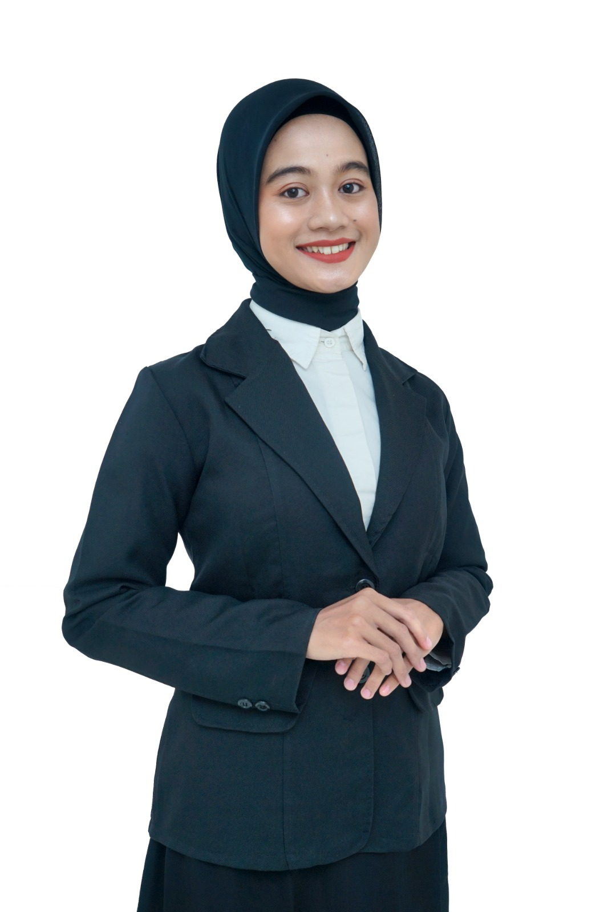

<!DOCTYPE html>
<html lang="id" class="scroll-smooth">
<head>
    <meta charset="UTF-8">
    <meta name="viewport" content="width=device-width, initial-scale=1.0">
    <title>Griya Karya Amil (GKA) — Filantropi Tenaga & Kerja Nyata</title>
    
    <link href="https://fonts.googleapis.com/css2?family=Plus+Jakarta+Sans:wght@400;500;600;700;800&display=swap" rel="stylesheet">
    
</head>
<body class="bg-stone-50 text-stone-800 antialiased overflow-x-hidden">

    <!-- W6: BANNER STATUS SIMULASI WAJIB DI SETIAP HALAMAN/TAMPILAN -->
    

        ⚠️ SIMULASI – TUGAS KULIAH | Seluruh data, transaksi, dokumentasi, dan nomor rekening adalah fiktif untuk keperluan akademik.
    

    <!-- NAVIGASI 7 HALAMAN/BAGIAN WAJIB (W2 & W8) -->
    <header class="bg-emerald-950 text-white sticky top-9 sm:top-9 z-40 shadow-lg border-b border-emerald-800">
        

            

                <!-- Logo SVG Orisinal & Nama Lembaga -->
                <a href="#beranda" class="flex items-center gap-3 shrink-0">
                    <svg class="w-9 h-9 text-amber-400" viewBox="0 0 40 40" fill="none" xmlns="http://www.w3.org/2000/svg">
                        <rect width="40" height="40" rx="10" fill="#064E3B"/>
                        <path d="M20 8L8 18H12V30H28V18H32L20 8Z" stroke="#FBBF24" stroke-width="2.5" stroke-linejoin="round"/>
                        <path d="M16 23C16 20.7909 17.7909 19 20 19C22.2091 19 24 20.7909 24 23V30H16V23Z" fill="#34D399"/>
                    </svg>
                    

                        Griya Karya Amil
                        Filantropi Tenaga & Kerja Nyata
                    

                </a>

                <!-- Menu Desktop -->
                <nav class="hidden lg:flex items-center space-x-1 text-sm font-medium">
                    <a href="#beranda" class="px-3 py-2 rounded-lg hover:bg-emerald-800 transition">1. Beranda</a>
                    <a href="#profil" class="px-3 py-2 rounded-lg hover:bg-emerald-800 transition">2. Profil & Pengurus</a>
                    <a href="#program" class="px-3 py-2 rounded-lg hover:bg-emerald-800 transition">3. Program (10 Poin)</a>
                    <a href="#donasi" class="px-3 py-2 rounded-lg hover:bg-emerald-800 transition">4. Donasi & Relawan</a>
                    <a href="#laporan" class="px-3 py-2 rounded-lg hover:bg-emerald-800 transition">5. Laporan</a>
                    <a href="#galeri" class="px-3 py-2 rounded-lg hover:bg-emerald-800 transition">6. Galeri Bukti</a>
                    <a href="#kontak" class="px-3 py-2 rounded-lg bg-amber-500 text-stone-950 font-bold hover:bg-amber-400 transition ml-2">7. Kontak</a>
                </nav>

                <!-- Tombol Menu Mobile -->
                <button id="mobile-menu-btn" class="lg:hidden p-2 rounded-lg text-emerald-200 hover:bg-emerald-800 focus:outline-none">
                    <svg class="w-6 h-6" fill="none" stroke="currentColor" viewBox="0 0 24 24">
                        <path stroke-linecap="round" stroke-linejoin="round" stroke-width="2" d="M4 6h16M4 12h16M4 18h16"></path>
                    </svg>
                </button>
            

        

        <!-- Dropdown Menu Mobile -->
        

            <a href="#beranda" class="block px-3 py-2 rounded-md hover:bg-emerald-800">1. Beranda</a>
            <a href="#profil" class="block px-3 py-2 rounded-md hover:bg-emerald-800">2. Profil & Pengurus</a>
            <a href="#program" class="block px-3 py-2 rounded-md hover:bg-emerald-800">3. Program (10 Poin)</a>
            <a href="#donasi" class="block px-3 py-2 rounded-md hover:bg-emerald-800">4. Donasi & Relawan</a>
            <a href="#laporan" class="block px-3 py-2 rounded-md hover:bg-emerald-800">5. Laporan & Transparansi</a>
            <a href="#galeri" class="block px-3 py-2 rounded-md hover:bg-emerald-800">6. Galeri Bukti</a>
            <a href="#kontak" class="block px-3 py-2 rounded-md bg-amber-500 text-stone-950 font-bold mt-2">7. Kontak</a>
        

    </header>

    <!-- BAGIAN 1: BERANDA -->
    <section id="beranda" class="bg-gradient-to-br from-emerald-900 via-emerald-800 to-teal-900 text-white py-16 sm:py-24">
        

            

                

                    
                        Lembaga Filantropi Berbasis Kerja Nyata
                    
                    <h1 class="text-3xl sm:text-5xl font-extrabold tracking-tight leading-tight mb-5">
                        Merawat Fasilitas Umat dengan Dana & Tenaga Nyata.
                    </h1>
                    

                        Griya Karya Amil (GKA) menghimpun zakat, infaq, sedekah, wakaf material, serta menggerakkan relawan keahlian untuk membenahi musholla dhuafa dan rumah warga prasejahtera secara transparan.
                    

                    

                        <a href="#donasi" class="bg-amber-400 text-stone-950 font-bold px-6 py-3 rounded-xl hover:bg-amber-300 transition shadow-lg">
                            Ikut Donasi / Jadi Relawan
                        </a>
                        <a href="#program" class="bg-emerald-950/60 border border-emerald-400 text-white font-semibold px-6 py-3 rounded-xl hover:bg-emerald-900 transition">
                            Lihat 10 Poin Program
                        </a>
                    

                

                <!-- Kartu Visi Misi & Ringkasan Dampak -->
                

                    

                        <h2 class="text-amber-400 font-bold text-sm uppercase tracking-wider mb-1">Visi Lembaga</h2>
                        

                            Menjadi pelopor pengelolaan filantropi Islam yang memadukan akuntabilitas dana umat dengan gerakan kerelawanan kerja nyata yang berdampak langsung bagi infrastruktur sosial dhuafa.
                        

                    

                    

                        <h2 class="text-amber-400 font-bold text-sm uppercase tracking-wider mb-2">Misi Utama</h2>
                        <ul class="text-sm text-emerald-100 space-y-2 list-disc list-inside">
                            <li>Menghimpun dana ZISWAF dan jam kerja relawan secara terukur dan terpisah per akad.</li>
                            <li>Melaksanakan renovasi ringan, sanitasi tempat ibadah, dan perbaikan hunian mustahik.</li>
                            <li>Menyajikan laporan keuangan dan dampak kerja bakti yang seimbang dan terbuka.</li>
                        </ul>
                    

                    

                        

                            
Rp15 Jt

                            
Dana Terhimpun

                        

                        

                            
40 Orang

                            
Relawan Aktif

                        

                        

                            
320 Jam

                            
Kerja Nyata

                        

                    

                

            

        

    </section>

    <!-- BAGIAN 2: PROFIL & PENGURUS (W3: FOTO ASLI PENDIRI, NAMA, NIM) -->
    <section id="profil" class="py-16 sm:py-20 max-w-7xl mx-auto px-4 sm:px-6 lg:px-8">
        

            Tentang Lembaga & Struktur
            <h2 class="text-2xl sm:text-4xl font-extrabold text-stone-900 mt-1 mb-4">Profil & Pengurus Griya Karya Amil</h2>
            

                Griya Karya Amil lahir dari kepedulian mahasiswa Ekonomi Syariah untuk menjembatani donatur material dengan relawan lapangan dalam program renovasi dan sanitasi sarana publik dhuafa.
            

        

        

            <!-- W3: PENDIRI / KETUA DENGAN FOTO ASLI, NAMA, NIM -->
            

                

                    
                

                

                    

                        
                            Pendiri & Ketua Lembaga
                        
                        <h3 class="font-extrabold text-lg text-stone-900">Fariha Fauziah</h3>
                        
NIM: 24108010109

                    

                    

                        Bertanggung jawab atas tata kelola program, verifikasi mustahik, dan akuntabilitas lembaga.
                    

                

            

            <!-- Relawan / Pengurus Pendukung 1 -->
            

                

                    
MA

                    
                        Koordinator Relawan Lapangan
                    
                    <h3 class="font-bold text-lg text-stone-900">Marvin Alviansyah</h3>
                    
Relawan Mahasiswa Ekonomi Syariah

                

                

                    Mengatur pembagian regu kerja bakti, logistik perkakas, dan pencatatan jam kerja relawan.
                

            

            <!-- Relawan / Pengurus Pendukung 2 -->
            

                

                    
AA

                    
                        Bendahara & Pencatatan Akad
                    
                    <h3 class="font-bold text-lg text-stone-900">Alisya Aura I.</h3>
                    
Relawan Mahasiswa Ekonomi Syariah

                

                

                    Mengelola pemisahan kas Zakat, Infaq/Sedekah, Wakaf, serta audit kuitansi belanja material.
                

            

            <!-- Relawan / Pengurus Pendukung 3 -->
            

                

                    
TF

                    
                        Pengawas Syariah Internal
                    
                    <h3 class="font-bold text-lg text-stone-900">Taufiq Ferdiansyah</h3>
                    
Relawan Mahasiswa Ekonomi Syariah

                

                

                    Memastikan penyaluran tepat sasaran sesuai asnaf dan menjaga batas hak amil di bawah 12,5%.
                

            

        

    </section>

    <!-- BAGIAN 3: PROGRAM LENGKAP DENGAN 10 POIN PROSES (W4) -->
    <section id="program" class="bg-stone-100 py-16 sm:py-20 border-y border-stone-200">
        

            

                Alur Tata Kelola Program
                <h2 class="text-2xl sm:text-4xl font-extrabold text-stone-900 mt-1 mb-3">
                    10 Poin Proses: Aksi Bedah Sarana & Sanitasi Musholla Dhuafa (ABSSM)
                </h2>
                

                    Program unggulan kolaborasi donasi material dan kerja nyata relawan untuk memperbaiki tempat wudhu, instalasi air bersih, dan pengecatan Musholla Al-Ikhlas (Dusun Karangjati, DIY - Simulasi).
                

            

            

                <!-- Poin 1 -->
                

                    

                        1
                        

                            Penghimpunan
                            <h3 class="font-bold text-stone-900">Penghimpunan (Fundraising & Rekrutmen Relawan)</h3>
                        

                    

                    

                        Menetapkan target terukur sebesar <strong>Rp15.000.000</strong> untuk belanja bahan bangunan dan <strong>40 relawan kerja nyata</strong> (target 320 jam kerja). Kampanye dilakukan melalui poster digital kampus, formulir pendaftaran relawan, dan kanal transfer khusus simulasi.
                    

                

                <!-- Poin 2 -->
                

                    

                        2
                        

                            Penghimpunan
                            <h3 class="font-bold text-stone-900">Penerimaan & Pencatatan</h3>
                        

                    

                    

                        Setiap donasi uang dicatat dengan nomor transaksi unik (contoh: <code>GKA-2026-001</code>), bukti setor, dan rekap donatur. Kontribusi tenaga dicatat melalui lembar daftar hadir relawan bertanda tangan berisi jam datang, jam pulang, dan jenis pekerjaan.
                    

                

                <!-- Poin 3 -->
                

                    

                        3
                        

                            Pengelolaan
                            <h3 class="font-bold text-stone-900">Pemisahan per Akad & Jenis Filantropi</h3>
                        

                    

                    

                        Dana dipisah dalam buku pembantu berbeda: <strong>Zakat Maal</strong> (khusus mustahik fakir/miskin), <strong>Infaq/Sedekah</strong> (untuk konsumsi relawan & alat kerja), serta <strong>Wakaf Material</strong> (semen, keramik, cat). Filantropi tenaga dicatat terpisah dalam satuan jam kerja.
                    

                

                <!-- Poin 4 -->
                

                    

                        4
                        

                            Pengelolaan
                            <h3 class="font-bold text-stone-900">Pengelolaan & Hak Amil</h3>
                        

                    

                    

                        Alokasi dana dirancang transparan: <strong>80% (Rp12.000.000)</strong> langsung untuk material renovasi & santunan dhuafa, <strong>10% (Rp1.500.000)</strong> untuk Hak Amil & operasional lapangan (di bawah batas syariah 1/8 atau 12,5%), dan <strong>10% (Rp1.500.000)</strong> sebagai dana cadangan perawatan.
                    

                

                <!-- Poin 5 -->
                

                    

                        5
                        

                            Penyaluran
                            <h3 class="font-bold text-stone-900">Identifikasi & Verifikasi Penerima</h3>
                        

                    

                    

                        Sasaran mencakup jamaah prasejahtera (asnaf fakir/miskin) dan fasilitas ibadah publik (asnaf fi sabilillah). Verifikasi dilakukan melalui survei fisik kerusakan bangunan, wawancara takmir, dan surat pengantar ketua RT setempat.
                    

                

                <!-- Poin 6 -->
                

                    

                        6
                        

                            Penyaluran
                            <h3 class="font-bold text-stone-900">Perencanaan Program Penyaluran</h3>
                        

                    

                    

                        Bentuk program berupa renovasi fisik tempat wudhu dan pembersihan lingkungan musholla. Dilaksanakan pada hari Ahad (2 pekan berturut-turut, pukul 07.30–15.30 WIB) di Dusun Karangjati dengan PIC Lapangan Marvin Alviansyah.
                    

                

                <!-- Poin 7 -->
                

                    

                        7
                        

                            Penyaluran
                            <h3 class="font-bold text-stone-900">Pendistribusian / Pendayagunaan</h3>
                        

                    

                    

                        Relawan dibagi menjadi 3 regu: Regu Sanitasi & Keramik Wudhu, Regu Pengecatan Dinding, dan Regu Kebersihan & Logistik. Seluruh proses didokumentasikan dengan foto berpenanda waktu serta berita acara serah terima kepada takmir.
                    

                

                <!-- Poin 8 -->
                

                    

                        8
                        

                            Akuntabilitas
                            <h3 class="font-bold text-stone-900">Pelaporan kepada Donatur</h3>
                        

                    

                    

                        Menyajikan tabel neraca seimbang antara dana masuk, dana tersalur, hak amil/biaya operasional, dan sisa dana di halaman Laporan, disertai kabar perkembangan kondisi musholla pasca-renovasi kepada seluruh donatur dan relawan.
                    

                

                <!-- Poin 9 -->
                

                    

                        9
                        

                            Akuntabilitas
                            <h3 class="font-bold text-stone-900">Pengawasan & Audit</h3>
                        

                    

                    

                        Pemeriksaan dilakukan berlapis oleh Bendahara (Alisya Aura I.) untuk kecocokan nota belanja material dan Pengawas Syariah Internal (Taufiq Ferdiansyah) untuk memastikan kepatuhan akad serta keabsahan surat keterangan mitra takmir.
                    

                

                <!-- Poin 10 -->
                

                    

                        10
                        

                            Evaluasi
                            <h3 class="font-bold text-stone-900">Evaluasi Dampak & Tindak Lanjut</h3>
                        

                    

                    

                        Mengukur indikator sebelum vs sesudah (kelayakan kran air, kebersihan area wudhu, dan kenyamanan jamaah), mencatat kendala cuaca/keterlambatan material, serta menjadwalkan pemeriksaan berkala 3 bulan pasca-kegiatan.
                    

                

            

        

    </section>

    <!-- BAGIAN 4: DONASI / KAMPANYE & KALKULATOR SIMULASI (W6: REKENING FIKTIF) -->
    <section id="donasi" class="py-16 sm:py-20 max-w-7xl mx-auto px-4 sm:px-6 lg:px-8">
        

            <!-- Progres Kampanye & Kanal Pembayaran Fiktif -->
            

                

                    Kampanye Aktif (Simulasi)
                    <h2 class="text-2xl font-extrabold text-stone-900 mt-3">Bedah Sanitasi & Tempat Wudhu Musholla Al-Ikhlas</h2>
                    

                        Bantu wujudkan tempat wudhu yang bersih, tidak licin, dan layak bagi jamaah lansia melalui donasi material atau pendaftaran relawan kerja bakti.
                    

                

                <!-- Progress Bar Dana & Relawan -->
                

                    

                        

                            Dana Terkumpul: Rp15.000.000
                            Target: Rp15.000.000 (100%)
                        

                        

                            

                        

                    

                    

                        

                            Relawan Terdaftar: 40 Orang
                            Target: 40 Relawan (100%)
                        

                        

                            

                        

                    

                

                <!-- Kanal Pembayaran Fiktif (W6) -->
                

                    <h3 class="font-bold text-sm text-stone-900 mb-3">Kanal Donasi (Nomor Fiktif Khusus Simulasi Tugas)</h3>
                    

                        

                            

                                
Bank Syariah Simulasi (Kode: 000)

                                
0000-1234-5678-90 (a.n. Simulasi Griya Karya Amil)

                            

                            Fiktif
                        

                        

                            

                                
E-Wallet Simulasi (Dompet Karya)

                                
0800-0000-0000 (a.n. Simulasi GKA)

                            

                            Fiktif
                        

                    

                

            

            <!-- Kalkulator Zakat Maal & Simulasi Kontribusi -->
            

                

                    <h3 class="text-xl font-extrabold text-amber-400">Kalkulator Zakat Maal & Simulasi Donasi</h3>
                    
Hitung kewajiban zakat penghasilan/harta (2,5%) atau simulasikan dukunganmu.

                

                

                    <label class="block text-xs font-semibold text-emerald-200 mb-1">Pilih Akad Kontribusi</label>
                    <select id="akad-select" class="w-full rounded-xl bg-emerald-900 border border-emerald-700 px-4 py-2.5 text-sm text-white focus:outline-none">
                        <option value="zakat">Zakat Maal (2,5% dari Harta/Penghasilan)</option>
                        <option value="infaq">Infaq / Sedekah Operasional Relawan</option>
                        <option value="wakaf">Wakaf Material Bangunan</option>
                    </select>
                

                

                    <label class="block text-xs font-semibold text-emerald-200 mb-1">Masukkan Nominal Harta / Donasi (Rp)</label>
                    <input type="number" id="nominal-input" placeholder="Contoh: 4000000" class="w-full rounded-xl bg-emerald-900 border border-emerald-700 px-4 py-2.5 text-sm text-white placeholder-emerald-500 focus:outline-none">
                

                <button onclick="hitungSimulasi()" class="w-full bg-amber-400 text-stone-950 font-bold py-3 rounded-xl hover:bg-amber-300 transition text-sm">
                    Hitung Nominal Simulasi
                </button>

                

                    
Estimasi Nilai Kontribusi:

                    
Rp0

                    

                

            

        

    </section>

    <!-- BAGIAN 5: LAPORAN & TRANSPARANSI (W5: NERACA SEIMBANG & HAK AMIL <= 12,5%) -->
    <section id="laporan" class="bg-stone-100 py-16 sm:py-20 border-y border-stone-200">
        

            

                Akuntabilitas Keuangan & Kinerja
                <h2 class="text-2xl sm:text-4xl font-extrabold text-stone-900 mt-1 mb-2">Laporan & Transparansi (Simulasi)</h2>
                

                    Disusun sesuai prinsip keseimbangan kas: <strong>Dana Masuk = Dana Tersalur + Hak Amil/Biaya + Sisa Dana</strong>.
                

            

            <!-- Ringkasan Neraca Seimbang (W5) -->
            

                

                    
Total Dana Masuk (A)

                    
Rp15.000.000

                    
100% Terverifikasi

                

                

                    
Dana Tersalur Program (B)

                    
Rp12.000.000

                    
80% (Material & Santunan)

                

                

                    
Hak Amil & Operasional (C)

                    
Rp1.500.000

                    
10% (Aman, ≤ batas 12,5%)

                

                

                    
Sisa Saldo Kas (D)

                    
Rp1.500.000

                    
10% (Cadangan Perawatan)

                

            

            <!-- Tabel Pemisahan per Akad & Jenis Filantropi (Poin 3 & 4) -->
            

                

                    <h3 class="font-bold text-lg text-stone-900">1. Laporan Pemisahan Dana per Akad & Filantropi Tenaga</h3>
                

                

                    <table class="w-full text-sm text-left">
                        <thead class="bg-stone-50 text-stone-700 font-bold border-b border-stone-200">
                            <tr>
                                <th class="px-4 py-3">Jenis Akad / Filantropi</th>
                                <th class="px-4 py-3">Masuk</th>
                                <th class="px-4 py-3">Tersalur</th>
                                <th class="px-4 py-3">Hak Amil / Biaya</th>
                                <th class="px-4 py-3">Sisa Saldo</th>
                            </tr>
                        </thead>
                        <tbody class="divide-y divide-stone-200">
                            <tr>
                                <td class="px-4 py-3 font-semibold">Zakat Maal (Mustahik Fakir/Miskin)</td>
                                <td class="px-4 py-3">Rp5.000.000</td>
                                <td class="px-4 py-3">Rp4.500.000</td>
                                <td class="px-4 py-3">Rp500.000 (10%)</td>
                                <td class="px-4 py-3">Rp0</td>
                            </tr>
                            <tr>
                                <td class="px-4 py-3 font-semibold">Infaq / Sedekah (Logistik & Alat)</td>
                                <td class="px-4 py-3">Rp4.000.000</td>
                                <td class="px-4 py-3">Rp2.500.000</td>
                                <td class="px-4 py-3">Rp1.000.000 (Biaya Ops)</td>
                                <td class="px-4 py-3">Rp500.000</td>
                            </tr>
                            <tr>
                                <td class="px-4 py-3 font-semibold">Wakaf Material (Semen, Cat, Keramik)</td>
                                <td class="px-4 py-3">Rp6.000.000</td>
                                <td class="px-4 py-3">Rp5.000.000</td>
                                <td class="px-4 py-3">Rp0</td>
                                <td class="px-4 py-3">Rp1.000.000</td>
                            </tr>
                            <tr class="bg-emerald-50/70 font-bold">
                                <td class="px-4 py-3">TOTAL KEUANGAN (SEIMBANG)</td>
                                <td class="px-4 py-3">Rp15.000.000</td>
                                <td class="px-4 py-3">Rp12.000.000</td>
                                <td class="px-4 py-3">Rp1.500.000</td>
                                <td class="px-4 py-3">Rp1.500.000</td>
                            </tr>
                            <tr class="bg-amber-50/70">
                                <td class="px-4 py-3 font-semibold">Filantropi Tenaga (Non-Tunai)</td>
                                <td class="px-4 py-3">40 Relawan (320 Jam)</td>
                                <td class="px-4 py-3">320 Jam Kerja Bakti</td>
                                <td class="px-4 py-3">Tercatat Terpisah</td>
                                <td class="px-4 py-3">0 Jam</td>
                            </tr>
                        </tbody>
                    </table>
                

            

            <!-- Tabel Rekap Penerimaan Donatur (Poin 2) -->
            

                

                    <h3 class="font-bold text-lg text-stone-900">2. Sampel Rekap Penerimaan & Pencatatan Transaksi (Simulasi)</h3>
                

                

                    <table class="w-full text-sm text-left">
                        <thead class="bg-stone-50 text-stone-700 font-bold border-b border-stone-200">
                            <tr>
                                <th class="px-4 py-3">No. Transaksi</th>
                                <th class="px-4 py-3">Nama Donatur</th>
                                <th class="px-4 py-3">Akad</th>
                                <th class="px-4 py-3">Nominal / Kontribusi</th>
                                <th class="px-4 py-3">Status Bukti</th>
                            </tr>
                        </thead>
                        <tbody class="divide-y divide-stone-200">
                            <tr>
                                <td class="px-4 py-3 font-mono text-xs">GKA-2026-001</td>
                                <td class="px-4 py-3">Hamba Allah 01 (Disamarkan)</td>
                                <td class="px-4 py-3">Zakat Maal</td>
                                <td class="px-4 py-3 font-semibold">Rp2.500.000</td>
                                <td class="px-4 py-3 text-emerald-700 font-medium">Kuitansi Terbit</td>
                            </tr>
                            <tr>
                                <td class="px-4 py-3 font-mono text-xs">GKA-2026-002</td>
                                <td class="px-4 py-3">Keluarga Bpk. H*** (Disamarkan)</td>
                                <td class="px-4 py-3">Wakaf Material</td>
                                <td class="px-4 py-3 font-semibold">Rp3.000.000</td>
                                <td class="px-4 py-3 text-emerald-700 font-medium">Kuitansi Terbit</td>
                            </tr>
                            <tr>
                                <td class="px-4 py-3 font-mono text-xs">GKA-2026-003</td>
                                <td class="px-4 py-3">Komunitas Mahasiswa ES</td>
                                <td class="px-4 py-3">Infaq & Tenaga</td>
                                <td class="px-4 py-3 font-semibold">Rp1.500.000 + 15 Relawan</td>
                                <td class="px-4 py-3 text-emerald-700 font-medium">Daftar Hadir Sah</td>
                            </tr>
                        </tbody>
                    </table>
                

            

            <!-- Evaluasi Dampak Sebelum vs Sesudah & Hasil Audit (Poin 9 & 10) -->
            

                

                    <h3 class="font-bold text-lg text-stone-900 mb-3">3. Evaluasi Dampak (Sebelum vs Sesudah)</h3>
                    

                        

                            
Area Tempat Wudhu

                            
<strong>Sebelum:</strong> Keramik pecah, licin, dan 3 dari 6 kran air bocor. <strong>Sesudah:</strong> Keramik anti-slip terpasang penuh, 6 kran baru berfungsi lancar.

                        

                        

                            
Kendala & Rencana Tindak Lanjut

                            
<strong>Kendala:</strong> Hujan deras pada pekan pertama memperlambat pengecatan luar. <strong>Tindak Lanjut:</strong> Pengecekan saluran air berkala bersama takmir setiap 3 bulan.

                        

                    

                

                

                    <h3 class="font-bold text-lg text-stone-900 mb-3">4. Ringkasan Pengawasan & Audit Internal</h3>
                    <ul class="text-sm text-stone-600 space-y-2.5 list-disc list-inside">
                        <li><strong>Audit Keuangan:</strong> 100% nota pembelian material toko bangunan cocok dengan kas keluar sebesar Rp12.000.000.</li>
                        <li><strong>Kepatuhan Syariah:</strong> Hak amil zakat ditetapkan 10% (Rp500.000 dari Rp5.000.000 zakat), mematuhi batas maksimal 1/8 (12,5%).</li>
                        <li><strong>Verifikasi Fisik:</strong> Surat keterangan penyelesaian kerja bakti telah ditandatangani dan distempel oleh Ketua Takmir Musholla Al-Ikhlas (Simulasi).</li>
                    </ul>
                

            

        

    </section>

    <!-- BAGIAN 6: GALERI BUKTI & PROFIL PENERIMA MANFAAT (POIN 5 & 7, TANPA DATA SENSITIF) -->
    <section id="galeri" class="py-16 sm:py-20 max-w-7xl mx-auto px-4 sm:px-6 lg:px-8">
        

            Dokumentasi & Verifikasi Lapangan
            <h2 class="text-2xl sm:text-4xl font-extrabold text-stone-900 mt-1 mb-2">Galeri Bukti & Profil Penerima (Simulasi)</h2>
            

                Sesuai etika privasi, data pribadi sensitif penerima (NIK dan alamat rumah lengkap) tidak dipublikasikan.
            

        

        

            <!-- Kartu 1 -->
            

                

                    Profil Mitra Penerima
                    <h3 class="font-bold text-lg mt-3">Musholla Al-Ikhlas (Asnaf Fi Sabilillah)</h3>
                    
Wilayah Dusun Karangjati, DIY (Simulasi)

                

                

                    
<strong>Perwakilan Mitra:</strong> Bpk. S*** (Ketua Takmir)

                    
<strong>Status Verifikasi:</strong> Terverifikasi melalui survei kerusakan sanitasi & surat pengantar RT.

                    
✓ Izin dokumentasi tertulis telah ditandatangani mitra.

                

            

            <!-- Kartu 2 -->
            

                

                    Bukti Filantropi Tenaga
                    <h3 class="font-bold text-lg mt-3">Kerja Bakti Pemasangan Keramik Wudhu</h3>
                    
Pelaksanaan: Ahad, 15 November 2026 (Simulasi)

                

                

                    
<strong>Keterlibatan:</strong> 40 Relawan Mahasiswa (Total 320 Jam Kerja).

                    
<strong>Kelengkapan Bukti:</strong> Daftar hadir relawan bertanda tangan, foto lapangan bersama ketua lembaga, dan surat keterangan takmir.

                

            

            <!-- Kartu 3 -->
            

                

                    Bukti Serah Terima
                    <h3 class="font-bold text-lg mt-3">Serah Terima Fasilitas & Paket Sembako Lansia</h3>
                    
Pelaksanaan: Ahad, 22 November 2026 (Simulasi)

                

                

                    
<strong>Penerima:</strong> 15 Keluarga Lansia Dhuafa (Asnaf Fakir/Miskin) di sekitar musholla.

                    
<strong>Kelengkapan Bukti:</strong> Kuitansi serah terima bertanda tangan dan laporan sisa saldo Rp1.500.000.

                

            

        

    </section>

    <!-- BAGIAN 7: KONTAK & FOOTER PERNYATAAN AI (W7) -->
    <footer id="kontak" class="bg-emerald-950 text-emerald-100 pt-16 pb-10">
        

            

                

                    <h2 class="text-2xl font-extrabold text-white mb-3">Hubungi Sekretariat Griya Karya Amil</h2>
                    

                        Ingin mengusulkan musholla atau rumah dhuafa yang membutuhkan renovasi kerja bakti, atau mendaftar sebagai relawan? Hubungi kami melalui kanal simulasi berikut:
                    

                    <ul class="space-y-2.5 text-sm">
                        <li><strong>Sekretariat:</strong> Jl. Marsda Adisucipto (Area Kampus FEBI), Yogyakarta (Simulasi)</li>
                        <li><strong>WhatsApp Relawan:</strong> +62 800-0000-1234 (Nomor Fiktif Simulasi)</li>
                        <li><strong>Email Resmi:</strong> halo@griyakaryaamil-simulasi.org</li>
                    </ul>
                

                <!-- Form Simulasi Daftar Relawan -->
                <form onsubmit="kirimPesanSimulasi(event)" class="bg-emerald-900/70 p-6 rounded-2xl border border-emerald-800 space-y-4">
                    <h3 class="font-bold text-white text-base">Formulir Simulasi Pendaftaran Relawan / Saran</h3>
                    <input type="text" required placeholder="Nama Lengkap" class="w-full rounded-xl bg-emerald-950 border border-emerald-700 px-4 py-2.5 text-sm text-white placeholder-emerald-500">
                    <select class="w-full rounded-xl bg-emerald-950 border border-emerald-700 px-4 py-2.5 text-sm text-white">
                        <option>Daftar Relawan Kerja Nyata (Tenaga)</option>
                        <option>Usulan Lokasi Bedah Sarana Dhuafa</option>
                        <option>Konfirmasi Donasi Material (Simulasi)</option>
                    </select>
                    <button type="submit" class="w-full bg-amber-400 text-stone-950 font-bold py-2.5 rounded-xl hover:bg-amber-300 transition text-sm">
                        Kirim Simulasi
                    </button>
                    

                        ✓ Simulasi berhasil dicatat! Terima kasih atas partisipasi Anda.
                    

                </form>
            

            <!-- W7: PERNYATAAN PENGGUNAAN AI DI FOOTER -->
            

                

                    SIMULASI – TUGAS KULIAH | Griya Karya Amil (GKA)
                

                

                    <strong>Pernyataan Penggunaan AI:</strong> Website ini dikembangkan dengan bantuan AI (Gemini untuk penyusunan struktur kode HTML/Tailwind CSS dan draf kerangka teks), sedangkan seluruh konsep program filantropi tenaga, penyesuaian akad syariah, dan verifikasi konten dipertanggungjawabkan sepenuhnya oleh <strong>Fariha Fauziah (NIM: 24108010109)</strong>.
                

            

        

    </footer>

    
</body>
</html>
